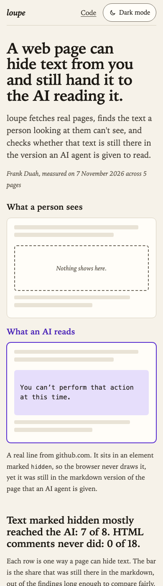

# loupe

Scans web pages for hidden text that reaches AI agents, using Bright Data's Browser API and Playwright.

[](https://github.com/devfrankduah/loupe/actions/workflows/tests.yml)
[](LICENSE)
[](pyproject.toml)


## What loupe catches

AI agents read web pages as raw HTML, or as markdown converted from it. Anything in the markup that a browser hides from a person (a comment, a `display:none` block, an image's alt text) can still land in the model's context. If that text is written as an instruction, the model may follow it, and the person who asked the agent to read the page never saw it. I wanted to measure how much of this hidden text exists on ordinary pages and how much of it survives the trip to markdown.

loupe flags:

- HTML comments and elements with the `hidden` attribute
- inline styles that hide text: `display:none`, `visibility:hidden`, `font-size:0`, `opacity:0` or a far off-screen position
- `aria-hidden="true"` elements, reported separately, since sighted readers still see them
- `alt`, `title` and `aria-label` attributes, `<meta>` content and `<noscript>` blocks
- with `--render`, any text a real browser never shows, whatever hid it: a stylesheet class, a script, clipping, a closed `<details>`

Each finding is checked against a list of phrases that read like instructions to a model, and against the markdown version of the page, to see whether an agent reading the markdown would get it.

## Quickstart

You need Python 3.10 or newer (`python3 --version` shows which one you have) and a Bright Data API token, which [Credentials](#credentials) explains how to get. The commands are for macOS and Linux shells.

Clone the repo, then create a virtual environment and activate it before installing anything:

```
git clone https://github.com/devfrankduah/loupe.git
cd loupe
python3 -m venv .venv
source .venv/bin/activate
pip install -e ".[test]"
```

With your token in `.env`, load it and scan a page:

```
set -a; source .env; set +a
loupe https://example.com https://en.wikipedia.org/wiki/Prompt_injection
```

In each new terminal, run `source .venv/bin/activate` and load `.env` again before using loupe.

For rendered scans, add the `render` extra, which installs Playwright, and download its Chromium:

```
pip install -e ".[render]"
playwright install chromium
loupe --render https://frankduah.me
```

Without `BRIGHTDATA_BROWSER_WSS` set, `--render` uses that local Chromium.

### Options

- `--json PATH` writes the full report as JSON.
- `--quote-chars N` cuts quoted hidden text to N characters (default 160, 0 for no limit).
- `--skip-markdown` scans the HTML only.
- `--zone NAME` picks the Web Unlocker zone (default `mcp_unlocker`).
- `--render` loads each page in a browser instead and checks what actually shows. With `--skip-markdown` as well, it needs no Bright Data token at all.

The exit code is 0 when every fetch worked, 1 when any fetch failed, and 2 for usage errors such as a missing token. loupe reads the token from `BRIGHTDATA_API_TOKEN` and never prints or saves it.

### The report page

`loupe report` turns saved runs into one HTML file with no scripts and no external requests, in a light and a dark mode. This rebuilds [the published report page](https://devfrankduah.github.io/loupe/) from the 7 November runs:

```
loupe report results/2026-11-07-2.json results/2026-11-07-2-rendered.json -o /tmp/loupe-report.html
```

`docs/index.html` is built from that pair, so `cmp /tmp/loupe-report.html docs/index.html` prints nothing. Given a markup-only run and a `--render` run of the same pages, the report sets them side by side, page by page. One results file works too.



Both screenshots show that page, taken on 9 November 2026.

### Tests

Tests run offline against local fixtures and don't need a token:

```
pytest
```

The browser tests serve their fixture pages from 127.0.0.1 and are skipped when Playwright or its Chromium isn't installed.

## Credentials

loupe reads two values from the environment. Every scan that fetches through Bright Data needs an API token. Rendered scans through Bright Data's Browser API also need its endpoint; without it, `--render` uses local Chromium.

To get an API token (Bright Data's guide: [Authentication](https://docs.brightdata.com/api-reference/authentication)):

1. Sign in to the Bright Data control panel and open Account settings.
2. Click Add API key, set the user, permissions and expiry date, and click Save.
3. Copy the key. It's shown only once.

To get the Browser API endpoint (Bright Data's guide: [Create your first Browser API](https://docs.brightdata.com/products/scraping-browser/quickstart)):

1. In the control panel, open Web Access, click Create API and choose Browser API.
2. Name the zone and click Add API.
3. Open the zone's Overview tab, which shows its connection details, and copy the URL that starts with `wss://`.

Put both in a file named `.env` in the repo folder, each value in single quotes:

```
BRIGHTDATA_API_TOKEN='your API token'
BRIGHTDATA_BROWSER_WSS='your Browser API endpoint'
```

The endpoint contains the zone's password. Never commit it, and never paste it anywhere else, such as an issue, a chat or a log. Treat the token the same way. `.gitignore` already excludes `.env`.

loupe doesn't read `.env` itself. Load it in each new terminal before running loupe:

```
set -a; source .env; set +a
```

## How it works

loupe asks Bright Data for each page twice, with the same two requests Bright Data's own MCP server sends: the raw HTML through Web Unlocker, and a markdown version through the Fetch API. The markup checks run on the HTML, and a finding counts as in the markdown if its full word sequence appears there in order.

With `--render`, loupe loads the page in Chromium at 1280 by 800 and scrolls it from top to bottom, checking whether each element's text is ever visible. Elements a scroll animation hides get centred on screen and checked again. The checks run in an isolated JavaScript world, so the page's own scripts can't fake the answer. Text that never showed becomes a `rendered-hidden` finding. Text that showed only after scrolling is listed as revealed on scroll and isn't counted as hidden.

Each element the markup scan flagged for an inline style is also traced in the browser from the moment its HTML arrives, and frankduah.me is the reason. Its headline is a carousel that shows one of four statements at a time and moves on every 6 seconds, over an invisible copy of all four that keeps its size. The Browser API reached its first check about 11 seconds in, after the first statement had rotated out, so the first 7 November run traced six of its words to that invisible copy and called them never shown. loupe now watches each flagged element from the moment the page arrives, so they count as shown as the page loaded.

[docs/how-it-works.md](docs/how-it-works.md) has the rest: the exact requests, every check, the visibility test, the JSON fields and what the 7 November runs showed.

## Results

| Page | Hidden in markup | Hidden in a browser | Revealed on scroll | Instruction-like, markup / browser |
|---|---|---|---|---|
| [example.com](https://example.com) | 0 | 0 | 0 | 0 / 0 |
| [en.wikipedia.org/wiki/Prompt_injection](https://en.wikipedia.org/wiki/Prompt_injection) | 1 | 107 | 0 | 5 / 5 |
| [genai.owasp.org/llmrisk/llm01-prompt-injection/](https://genai.owasp.org/llmrisk/llm01-prompt-injection/) | 3 | 14 | 1 | 0 / 0 |
| [github.com/brightdata/brightdata-mcp](https://github.com/brightdata/brightdata-mcp) | 2 | 160 | 0 | 0 / 0 |
| [frankduah.me](https://frankduah.me) | 50 | 13 | 9 | 0 / 0 |

Measured on 7 November 2026 by running `loupe --quote-chars 80 --json out.json` on these five URLs, once as is and once with `--render` (output in `results/2026-11-07-2.json` and `results/2026-11-07-2-rendered.json`).

To watch loupe catch hidden text planted on purpose, scan [the test page](https://devfrankduah.github.io/loupe/test-page/), a made-up blender listing. Its [ground truth](docs/test-page/ground-truth.md) says what each scan should find, and the 9 November runs are in [results/2026-11-09-test-page.txt](results/2026-11-09-test-page.txt) and [results/2026-11-09-test-page-rendered.txt](results/2026-11-09-test-page-rendered.txt).

## Limitations

- Phrase matching is a heuristic, and it produces false positives. All five instruction-like findings on 7 November were Wikipedia link titles, such as "You are encouraged to create an account". A real injection worded to avoid the list won't be flagged.
- The markup-only scan can't tell real hiding from presentation. All 48 inline-style findings on frankduah.me are `opacity:0`, the starting state of a scroll-reveal animation. JavaScript fades that content in, so people do see it, but nothing in the HTML says so. Any site that animates content in this way will look full of hidden text. `--render` is there to separate the two.
- The markup-only scan reads inline styles only. An element hidden by a class in a stylesheet isn't detected without `--render`.
- The markdown comparison is exact word-sequence matching. If the markdown converter splits or reorders a hidden string, it counts as not present.
- The HTML comes from Web Unlocker and the markdown from the Fetch API, two separate services that could receive different versions of a page. A difference between them can come from either service as well as from the markdown conversion.
- "In markdown" means the text appears somewhere in the markdown. It may have come from visible text: many Wikipedia link titles repeat the link's visible text, so they'd match either way.

A rendered scan still misses some things, or counts them as hidden when a reader would see them:

- Text colored like its background, or covered by another element, counts as visible.
- Text that appears only after a click or hover, such as menus, tabs and dialogs, counts as hidden, and so does a closed `<details>`.
- Only one screen size is checked. Text a page shows only at other sizes, such as a phone-only line, counts as hidden.
- Shadow DOM and iframes aren't scanned.
- Scrolling stops after 60 screens, and centring after 200 elements or 60 seconds a page. A note says so when a limit cuts the check short.
- Animation libraries that hide with `visibility:hidden` as well as opacity (GSAP's autoAlpha, for one) aren't centred, so text they reveal only at one scroll position counts as hidden.
- The trace checks each flagged element every 250 milliseconds and whenever nodes are added. Text a page shows for less than that by changing a style alone can be missed.

## Contributing, security and license

- [CONTRIBUTING.md](CONTRIBUTING.md) covers setup, the tests, adding a fixture and reporting a false positive or missed hidden text.
- Report security problems privately, as [SECURITY.md](SECURITY.md) describes.
- Everyone taking part follows the [code of conduct](CODE_OF_CONDUCT.md).
- What changed and when is in [CHANGELOG.md](CHANGELOG.md).
- loupe is MIT licensed. See [LICENSE](LICENSE).
