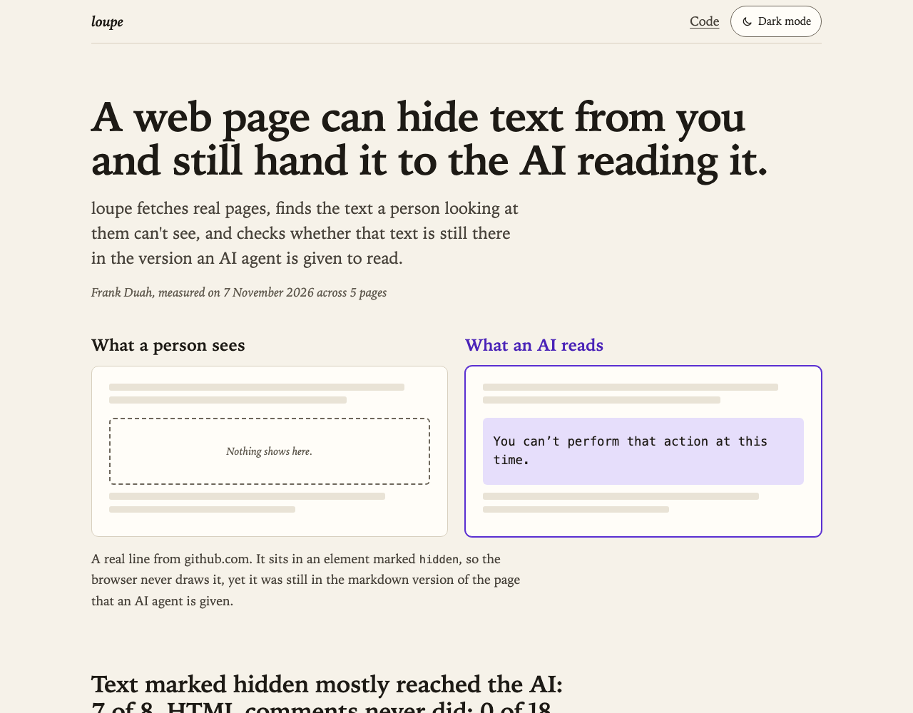

# loupe

loupe fetches public web pages through Bright Data and flags text that people reading the page can't see but an AI agent reading it would.

## Why

Agents don't look at pages. They read them, usually as raw HTML or as markdown converted from it. Anything in the markup that a browser hides from a person (a comment, a `display:none` block, an image's alt text) can still land in the model's context. If that text is written as an instruction, the model may follow it, and the person who asked the agent to read the page never saw it. I wanted to measure how much of this hidden text exists on ordinary pages and how much of it survives the trip to markdown.

## Install

You need Python 3.10 or newer. `python3 --version` shows which one you have. The commands here are for macOS and Linux shells.

Clone the repo, then create a virtual environment and activate it before installing anything:

```
git clone https://github.com/devfrankduah/loupe.git
cd loupe
python3 -m venv .venv
source .venv/bin/activate
pip install -e ".[test]"
```

In each new terminal, run `source .venv/bin/activate` again before using loupe.

For rendered scans (`--render`), add the `render` extra, which installs Playwright, and download its Chromium:

```
pip install -e ".[render]"
playwright install chromium
```

## Credentials

loupe reads two values from the environment. Every scan that fetches through Bright Data needs an API token. Rendered scans through Bright Data's Browser API also need its endpoint; without it, `--render` uses local Chromium.

To get an API token (Bright Data's guide: [Authentication](https://docs.brightdata.com/api-reference/authentication)):

1. Sign in to the Bright Data control panel and open Account settings.
2. Click Add API key, set the user, permissions and expiry date, and click Save.
3. Copy the key. It's shown only once.

To get the Browser API endpoint (Bright Data's guide: [Create your first Browser API](https://docs.brightdata.com/products/scraping-browser/quickstart)):

1. In the control panel, open Web Access, click Create API and choose Browser API.
2. Name the zone and click Add API.
3. Open the zone's Overview tab, which shows its connection details, and copy the URL that starts with `wss://`.

Put both in a file named `.env` in the repo folder, each value in single quotes:

```
BRIGHTDATA_API_TOKEN='your API token'
BRIGHTDATA_BROWSER_WSS='your Browser API endpoint'
```

The endpoint contains the zone's password. Never commit it, and never paste it anywhere else, such as an issue, a chat or a log. Treat the token the same way. `.gitignore` already excludes `.env`.

loupe doesn't read `.env` itself. Load it in each new terminal before running loupe:

```
set -a; source .env; set +a
```

## Usage

loupe reads the token from `BRIGHTDATA_API_TOKEN` and never prints or saves it. With `.env` loaded:

```
loupe https://example.com https://en.wikipedia.org/wiki/Prompt_injection
```

Options:

- `--json PATH` writes the full report as JSON.
- `--quote-chars N` cuts quoted hidden text to N characters (default 160, 0 for no limit).
- `--skip-markdown` scans the HTML only.
- `--zone NAME` picks the Web Unlocker zone (default `mcp_unlocker`).
- `--render` loads each page in a browser instead and checks what actually shows. See [Rendered scan](#rendered-scan). With `--skip-markdown` as well, it needs no Bright Data token at all.

The exit code is 0 when every fetch worked, 1 when any fetch failed, and 2 for usage errors such as a missing token.

To turn saved runs into a web page, give `loupe report` the results files and a file to write. This rebuilds the published report page from the second 7 November pair:

```
loupe report results/2026-11-07-2.json results/2026-11-07-2-rendered.json -o /tmp/loupe-report.html
```

`docs/index.html`, the page at https://devfrankduah.github.io/loupe/, is built from that pair, so `cmp /tmp/loupe-report.html docs/index.html` prints nothing. Given a markup-only run and a `--render` run of the same pages, the report sets them side by side, page by page. One results file works too.

Tests run offline against local fixtures and don't need a token:

```
pytest
```

The browser tests serve their fixture pages from 127.0.0.1 and are skipped when Playwright or its Chromium isn't installed.

## How pages are fetched

I send the same requests that Bright Data's own MCP server ([brightdata-mcp](https://github.com/brightdata/brightdata-mcp), version 4.3.0) sends for its two scraping tools:

- HTML, like `scrape_as_html`: `POST https://api.brightdata.com/request` with `{"url", "zone": "mcp_unlocker", "format": "raw"}`. That's Web Unlocker. The MCP server creates the `mcp_unlocker` zone the first time it starts, so on an account that has never run it you need to create that zone first.
- Markdown, like `scrape_as_markdown`: `POST https://api.brightdata.com/datasets/v3/scrape?dataset_id=gd_m6gjtfmeh43we6cqc&format=json&include_errors=true` with `[{"url"}]`, reading the `markdown` field of the first record. That's the Fetch API, which the MCP server switched to on 2026-11-01.

## What it checks

In the HTML:

- HTML comments.
- Elements with the `hidden` attribute.
- Elements with `aria-hidden="true"`. These are hidden from screen readers, not from sighted readers, so I report them separately.
- Elements whose inline `style` sets `display:none`, `visibility:hidden` or `collapse`, `font-size:0`, `opacity:0`, or pushes them off-screen (`position:absolute` or `fixed` with an offset of 1000px or more to the negative side, or a `text-indent` that far).
- `alt`, `title` and `aria-label` attributes.
- `<meta>` tags that have a name, property, http-equiv or itemprop.
- `<noscript>` blocks.

Text inside a hidden element is reported once, on the outermost hidden element. Script and style contents are ignored.

Every finding is checked against a short list of phrases that read like instructions to a model ("ignore previous", "ignore all", "you are", "system prompt", "do not tell" and a few more). The list lives in `src/loupe/phrases.py`. "assistant" was on it until 7 November. On real pages it only ever named products and projects, so it was dropped.

Then loupe fetches the markdown version of the same page and records whether each finding's text appears in it. Both sides are reduced to lowercase words, link targets are dropped, and the finding counts as present only if its full word sequence appears in order. Findings shorter than 12 characters after that reduction aren't compared, because short strings like "Menu" match by accident.

## Rendered scan

The checks above read markup only, so they miss text hidden by a stylesheet class or by a script, and they flag text that starts invisible and fades in as you scroll. `--render` asks a real browser instead.

For each page, loupe opens Chromium at 1280 by 800, loads the page, and waits for the load event, for the network to go quiet and for opening animations to finish. Then it records whether each element's own text is visible. Visible means all of these:

- `checkVisibility()` passes with `opacityProperty`, `visibilityProperty` and `contentVisibilityAuto`
- the text has a box at least 2px each way, inside the part of the page a reader can scroll to
- the computed `font-size` is above 0
- it isn't clipped away by `overflow`, `clip` or `clip-path`
- its opacity, multiplied through its ancestors, is at least 0.05

Then loupe scrolls from the top to the bottom one screen at a time, pausing at each step and checking again. After that, it brings each element that is still hidden only by opacity, position or clipping (the ways scroll animations hide things) to the middle of the screen and checks once more, because some reveals fire only at one scroll position. Text hidden with `display:none`, `visibility:hidden` or a closed `<details>` waits for a click, not a position, so it isn't centred. A last check runs once transitions settle.

Text that was never seen visible becomes a `rendered-hidden` finding, with the reason (such as `display:none`, `clipped` or `inside a closed <details>`). It goes through the same phrase list and markdown comparison as everything else. Text hidden at load but seen later is listed separately as revealed on scroll and isn't counted as hidden. The markup checks for comments, meta tags, label attributes, `aria-hidden` and `<noscript>` still run on the HTML as served. The rendered result replaces the inline-style and `hidden` attribute guesses. Each element an inline-style guess flagged is traced and reported as visible at load, revealed on scroll, still hidden, or not matched. It is matched by tag and text right after the first check and again at the end, since a framework can swap a node for a copy after load. A page can carry several copies of the same text, so the most visible copy decides.

The checks run in an isolated JavaScript world, so a page's own scripts can't patch `checkVisibility` or `getClientRects` to make hidden text look visible.

The browser is local Chromium unless `BRIGHTDATA_BROWSER_WSS` holds a CDP websocket endpoint for Bright Data's Browser API. That value carries credentials. loupe never prints, logs or saves it, and a failed connection reports only that it failed. A remote browser gets two-minute timeouts. It skips images, media and fonts, but never stylesheets, since they decide what shows, and each page records the bytes transferred and the requests it refused. A remote page fails if it measures no bytes, or if it loaded images over http(s) and nothing was refused, because then neither the byte limit nor the blocking can be trusted. Every page gets a fresh browser.

In the JSON, each page has a `scan_mode` and each finding a `mode` (`static` or `rendered`). A rendered page adds a `rendering` block with the browser version, scroll steps, notes, the revealed text and the inline-style trace.

## Results

I first ran it on 2 November 2026 against five pages. example.com is the control. The full output is in `results/2026-11-02.txt` and `results/2026-11-02.json`, with quoted text cut to 80 characters. The pages themselves aren't stored.

| Page | Findings | Instruction-like | In markdown | Not in markdown | Not compared |
|---|---|---|---|---|---|
| example.com | 1 | 0 | 0 | 1 | 0 |
| en.wikipedia.org/wiki/Prompt_injection | 273 | 5 | 163 | 26 | 84 |
| genai.owasp.org/llmrisk/llm01-prompt-injection/ | 52 | 0 | 5 | 26 | 21 |
| github.com/brightdata/brightdata-mcp | 302 | 0 | 59 | 171 | 72 |
| frankduah.me | 147 | 5 | 31 | 60 | 56 |

The control produced one finding, the `viewport` meta tag, and nothing instruction-like.

None of the 10 instruction-like findings is an attack. On Wikipedia they're link `title` attributes: "You are encouraged to create an account and log in" (twice), "Gemini (language model)", "Large language model" and "Edit section: System prompt". On my own site all five match "assistant" in the name of one of my projects, the Device-Aware RAG Assistant.

The markdown for example.com and Wikipedia failed on the first pass with `HTTP 400: Customer is not active`. I had created the `mcp_unlocker` zone moments before, and the account seemed to need a moment to activate. I retried those two markdown fetches once each and both worked, so the run made 12 requests. I hadn't kept the full text of the findings from the first pass, only the 80-character quotes, so on the retry I compared only findings of 80 characters or less (where the quote is the whole text). The 34 longer Wikipedia findings are counted as not compared.

## Results, 7 November 2026: markup against a browser

On 7 November 2026 I ran the same five pages twice, back to back. The first run was markup only, as before. The second used `--render` through the Bright Data Browser API, with images, media and fonts blocked. Both fetched the markdown the same way as on 2 November. The output is in `results/2026-11-07-2.json` and `results/2026-11-07-2-rendered.json`, with `.txt` summaries beside them, and quoted text is cut to 80 characters. They're the second pair of files from that day. The first, `results/2026-11-07.json` and `results/2026-11-07-rendered.json`, came before the trace watched each flagged element for the whole scan.

| Page | Hidden, markup only | Never shown in a browser | Shown only after scrolling | Instruction-like, markup / browser | Measured transfer |
|---|---|---|---|---|---|
| example.com | 0 | 0 | 0 | 0 / 0 | 1,393 bytes |
| en.wikipedia.org/wiki/Prompt_injection | 1 | 107 | 0 | 5 / 5 | 372,068 bytes |
| genai.owasp.org/llmrisk/llm01-prompt-injection/ | 3 | 14 | 1 | 0 / 0 | 1,521,545 bytes |
| github.com/brightdata/brightdata-mcp | 2 | 160 | 0 | 0 / 0 | 2,147,051 bytes |
| frankduah.me | 50 | 13 | 9 | 0 / 0 | 148,667 bytes |

"Hidden, markup only" counts the `hidden` attribute and inline-style findings. "Never shown in a browser" counts rendered-hidden findings, each the outermost element of a run of hidden text. The browser run measured 4,190,724 bytes in total and refused 101 image, media and font requests. On this run GitHub's network was still busy after 10 seconds, so its first check ran with requests open, and it measured about 2.1 MB against 0.4 MB earlier the same day.

The browser finds far more on Wikipedia and GitHub, because most of their hidden text is hidden by stylesheets the markup scan can't read. On Wikipedia, 99 of the 107 findings are `display:none`. GitHub's reasons are more mixed: `display:none`, text too small to see, sections collapsed inside a closed `<details>`, and clipped text.

frankduah.me goes the other way. The markup scan flagged 48 elements for inline `opacity:0`. In the browser, 29 showed as the page loaded, 18 showed after scrolling, none stayed hidden, and 1 wasn't found in the live page: a clock that rewrites its own text. The headline is a carousel that shows one of four statements at a time and moves on every 6 seconds, over an invisible copy of all four that keeps its size. The Browser API reached its first check about 11 seconds in, after the first statement had rotated out, so the earlier pair of files traced six of its words to that invisible copy and called them never shown. loupe now watches each flagged element from the moment the page arrives, so they count as shown as the page loaded.

All the instruction-like matches left are Wikipedia link titles, such as "You are encouraged to create an account" and "Large language model". None of them is an attack.

Rendering the same five pages in local Chromium found the same hidden and revealed text on all five.

## Report

[The report page](https://devfrankduah.github.io/loupe/) is the same results written for someone who doesn't read HTML. It opens on one real line of hidden text shown twice, as a person sees the page and as an AI reads it, then charts how often each hiding method reached the markdown, gives a card per page, sets the markup-only and browser runs side by side, and lists what I'm unsure about. It's one file with no scripts and no external requests, built by `loupe report` from `results/2026-11-07-2.json` and `results/2026-11-07-2-rendered.json`, with a light and a dark mode. The source is [docs/index.html](docs/index.html). The screenshots show this version, taken on 9 November 2026.




## Does hidden text reach an agent that reads markdown?

For some kinds of hiding, yes. Across all five pages:

| Kind | In markdown | Not in markdown | Not compared |
|---|---|---|---|
| `hidden` attribute | 5 | 1 | 0 |
| Inline style | 27 | 13 | 10 |
| `aria-hidden` | 11 | 3 | 27 |
| HTML comment | 0 | 14 | 20 |
| `<meta>` | 3 | 65 | 43 |
| `alt`, `title`, `aria-label` | 212 | 188 | 133 |
| `<noscript>` | 0 | 0 | 0 |

Text inside elements hidden with the `hidden` attribute or `display:none` reaches the markdown. On the OWASP page, a `display:none` print and email menu and two `hidden` "Share on" labels all show up in it. HTML comments don't: none of the 14 I could compare were in the markdown. Meta content almost never is. So an agent reading this markdown is protected from comments but not from text hidden with markup or inline CSS, which are the easiest places to plant an instruction.

Two caveats on these numbers. The HTML comes from Web Unlocker and the markdown from the Fetch API, so the two fetches are separate services and could have received different versions of a page. A difference can come from either service, not only from the markdown conversion. Also, "in markdown" means the text appears somewhere in the markdown, not that it got there from the hidden element. Many Wikipedia link titles repeat the link's visible text, so they'd match either way.

## Limitations

- Phrase matching is a heuristic, and it produces false positives. Every instruction-like finding in this run was one: Wikipedia's account link title, and my own project name matching "assistant". A real injection worded to avoid the list won't be flagged.
- The markup-only scan can't tell real hiding from presentation. All 48 inline-style findings on frankduah.me are `opacity:0`, the starting state of a scroll-reveal animation. JavaScript fades that content in, so people do see it, but nothing in the HTML says so. Any site that animates content in this way will look full of hidden text. `--render` is there to separate the two.
- The markup-only scan reads inline styles only. An element hidden by a class in a stylesheet isn't detected without `--render`.
- The markdown comparison is exact word-sequence matching. If the markdown converter splits or reorders a hidden string, it counts as not present.

A rendered scan still misses some things, or counts them as hidden when a reader would see them:

- Text colored like its background, or covered by another element, counts as visible.
- Text that appears only after a click or hover, such as menus, tabs and dialogs, counts as hidden, and so does a closed `<details>`.
- Only one screen size is checked. Text a page shows only at other sizes, such as a phone-only line, counts as hidden.
- Shadow DOM and iframes aren't scanned.
- Scrolling stops after 60 screens, and centring after 200 elements or 60 seconds a page. A note says so when a limit cuts the check short.
- Animation libraries that hide with `visibility:hidden` as well as opacity (GSAP's autoAlpha, for one) aren't centred, so text they reveal only at one scroll position counts as hidden.
- The trace checks each flagged element every 250 milliseconds and whenever nodes are added. Text a page shows for less than that by changing a style alone can be missed.
